# Hi, I'm Mukti Kumari 👋

### Aspiring Software Development Engineer | Java Backend Developer

I'm a Computer Science student passionate about building backend applications, solving problems through Data Structures & Algorithms, and learning software engineering fundamentals.

- 🎓 B.Tech Computer Science & Engineering (2024–2028)
- 💻 Aspiring Software Development Engineer (SDE)
- ☕ Focused on Java, Spring Boot and Backend Development
- 🧠 Solved 400+ DSA problems across coding platforms
- ☁️ AWS Cloud Club Core Team Member
- 🚀 Team Lead – Google Solution Challenge 2026

---

## 🌐 Connect With Me

---

## 🛠️ Tech Stack

### Programming Languages

### Backend Development

### Databases

### Tools & Technologies

---

## 🚀 Featured Projects

### 1. SETU – Societal Innovation Collaboration Platform

**Java | Spring Boot | Spring Security | MySQL | FastAPI | Docker**

An AI-assisted collaboration platform connecting societal challenges with universities, student teams, mentors and industry partners.

- Developed backend REST APIs with authentication and role-based access.
- Integrated AI services for problem intelligence and collaborator matching.
- Containerized application services using Docker Compose.

🔗 [View Repository](https://github.com/MuktiKumari983/setu)

### 2. AI-Powered Smart Shop Management System

**JavaScript | Firebase | Firestore | Google Gemini**

A smart shop management application with billing, inventory and customer management features.

- Integrated Google Gemini for AI-assisted interactions.
- Led a three-member team for Google Solution Challenge 2026.

🔗 [View Repository](https://github.com/MuktiKumari983/Shop-Management)

### 3. Java DSA

**Java | Data Structures & Algorithms**

A collection of DSA solutions with explanations and time and space complexity analysis.

- Practising arrays, strings, linked lists, trees, graphs, recursion and dynamic programming.
- Focused on problem-solving patterns and optimized solutions.

🔗 [View Repository](https://github.com/MuktiKumari983/Java-DSA)

---

## 🎯 Currently Focused On

- Advanced Java and Object-Oriented Programming
- Data Structures & Algorithms
- Spring Boot and Spring Security
- Database Management and SQL
- Backend System Design
- Docker and AWS fundamentals
- Building reliable and scalable backend applications

---

## 🏆 Education & Achievements

- 🥇 **NPTEL Elite Certificate** – Data Structures and Algorithms Using Java, 70% (IIT Kharagpur).
- 💡 Solved **400+ DSA problems** across LeetCode, GeeksforGeeks and HackerRank.
- ☁️ **AWS Cloud Club, IEC** – Core Team Member.
- 🚀 **Google Solution Challenge 2026** – Team Lead.

---

## 📊 GitHub Statistics

## 📊 GitHub Statistics

  
  

---

## 💫 Developer Mindset

*"Great software is built one problem, one solution, and one line of code at a time."*

Thanks for visiting my profile! Feel free to explore my repositories and connect with me. 😊
